<!-- animated contribution graph built from real data; refreshed daily by
     .github/workflows/update-profile-art.yml -->

<h3><code>daniil@github ~ $ ./contributions.sh</code></h3>

 
 

<!-- ASCII portrait (left) and whoami card (right). Both SVGs are 840 x 880,
     so equal widths give equal heights.
     portrait: python scripts/prep_photo.py <photo> && python scripts/make_ascii_portrait.py
     card:     python scripts/render_whoami_card.py (edit profile.json first) -->

<h3><code>daniil@github ~ $ whoami</code></h3>

<table>
<tr>
<td valign="top"></td>
<td valign="top"></td>
</tr>
</table>

 
 

<h3><code>daniil@github ~ $ ./links.sh</code></h3>

<b>Marketing · Automation · Web</b>

 

